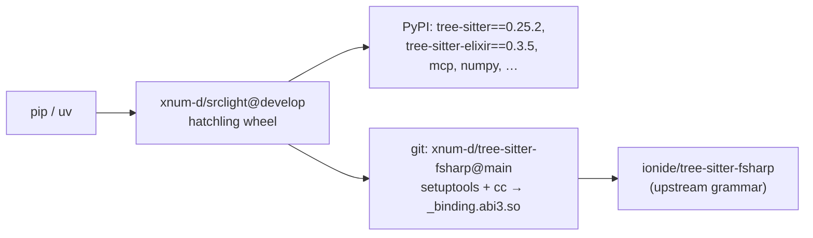

# Fork notes

This repository is a fork of [srclight/srclight](https://github.com/srclight/srclight),
maintained at [xnum-d/srclight](https://github.com/xnum-d/srclight). It adds AST-based
indexing for **F#** and **Elixir**, a schema that keeps same-line definitions distinct,
and reporting for files a grammar could only partially parse.

It is **not published on PyPI**. `pip install srclight` installs the unmodified upstream
release (`0.25.3`), which has none of the changes below. This fork reports
`0.25.3+native.1`: the `+native.N` local segment is what separates a fork build from
upstream at the same base version. Install this fork from its git URL — see [Install](#install).

| | |
|---|---|
| Upstream | `https://github.com/srclight/srclight` (branch `develop`) |
| This fork | `https://github.com/xnum-d/srclight` (default branch `develop`) |
| Fork point | `8fa3826` — *fix: stop returning learnings past their ttl_days…* |
| Companion grammar fork | `https://github.com/xnum-d/tree-sitter-fsharp` (branch `main`), forked from `ionide/tree-sitter-fsharp` |
| License | MIT, unchanged from upstream |

## What this fork changes

| Area | Upstream | This fork |
|---|---|---|
| Languages | 19 | 21 — adds F# (`.fs`, `.fsx`, `.fsi`) and Elixir (`.ex`, `.exs`) |
| F# / Elixir extraction | — | dedicated AST extractors (`srclight/fsharp.py`, `srclight/elixir.py`, shared `srclight/syntax.py`) instead of generic tag queries |
| F# grammar | `tree-sitter-fsharp==0.3.12` from PyPI | `0.3.12+srclight.1` built from the companion fork, which adds nullable type annotations (`string \| null`) and long inline branch columns |
| Symbol identity | schema v5, `UNIQUE(file_id, kind, name, start_line)` | schema v6, `UNIQUE(file_id, kind, name, qualified_name, start_line, start_column)` |
| Partial parses | invisible | `parse_errors` map: reported by the CLI, `index_status`, workspace project listings and `find_pattern` |
| Dev tooling | none | `mise.toml` with `setup` / `test` / `srclight` tasks |
| Packaging | publishable to PyPI | direct git dependency, so `tool.hatch.metadata.allow-direct-references = true` is required and PyPI upload is not possible |

### Schema v6 and the in-place migration

Two definitions on one line — an Elixir `def add/1` beside `def add/2`, or an F# binding
inside a `let … in` — used to collapse into one row, because the v5 identity was
`(file, kind, name, line)`. v6 adds `qualified_name` and `start_column` to the identity.

Existing indexes are upgraded in place by `Database._migrate_symbol_identity()`, which runs
whenever a `symbols` table has no `start_column`. It rebuilds the table from the same column
list `SCHEMA_SQL` uses and copies rows **by column name, never by position**, so:

- symbol IDs are preserved, and with them parent links, graph edges, embedding rows and
  FTS5 rowids — search keeps working without re-embedding;
- a migrated `symbols` table is identical to a fresh one, column order included;
- the migration is idempotent (`server.py` opens and initializes the same index many times
  per session).

The rebuild is wrapped in `BEGIN IMMEDIATE` with `foreign_keys=OFF`, checked with
`PRAGMA foreign_key_check`, and rolled back on any error. It is covered by
`tests/test_db.py::test_v5_index_survives_the_v6_migration` and its neighbours.

### Syntax gaps are reported, not hidden

`parse_errors` maps a path to the line ranges a grammar could not parse. It survives
unchanged-file reindexes and clears when the file is repaired or removed. Source is never
rewritten to make unsupported syntax parse. A non-empty map means the answer you are holding
is not a whole-tree answer — the same contract `unindexed_extensions` already had.

F# and Elixir support is a **syntax index, not a compiler-accurate reference service**:
F# type inference, overloads and higher-order dispatch, and Elixir generated or dynamic code
still need a compiler or LSP to confirm.

## Install

Requirements: **Python 3.11+**, **git**, network access, and a **C compiler** — the F#
grammar has no prebuilt wheels in the fork, so `pip` compiles `_binding.abi3.so` from source
(about a minute). Optional extras (`docs`, `pdf`, `ocr`, `paddleocr`, `gpu`) and Ollama for
embeddings work exactly as upstream.

```bash
# pip, into a fresh environment
python -m venv .venv
.venv/bin/pip install "srclight @ git+https://github.com/xnum-d/srclight@develop"

# uv
uv venv .venv
uv pip install --python .venv/bin/python \
  "srclight @ git+https://github.com/xnum-d/srclight@develop"
```

`@develop` is the fork's default branch and a **moving** reference. For a reproducible
install, pin a commit or a tag instead:

```bash
pip install "srclight @ git+https://github.com/xnum-d/srclight@<sha>"
```

Verify that you got the fork and not upstream:

```bash
.venv/bin/pip show srclight tree-sitter-fsharp | grep -E '^(Name|Version)'
# srclight              0.25.3+native.1       ← upstream reports plain 0.25.3
# tree-sitter-fsharp    0.3.12+srclight.1     ← PyPI's build reports plain 0.3.12
```

Both local segments are the tell. PyPI's `tree-sitter-fsharp 0.3.12` carries the same base
number but neither nullable type annotations nor the scanner fixes, and PyPI's
`srclight 0.25.3` has no F# or Elixir support. A `+` suffix on either package means the build
came from a fork. Note that PEP 440 ignores the local segment when matching, so an installed
`0.25.3+native.1` also satisfies `srclight==0.25.3`.

### As a dependency of another project

```toml
dependencies = ["srclight @ git+https://github.com/xnum-d/srclight@develop"]
```

If that project also builds with hatchling, it needs its own
`[tool.hatch.metadata] allow-direct-references = true` — the restriction applies one level
up too.

### From a clone (development install)

```bash
git clone https://github.com/xnum-d/srclight.git
cd srclight
python -m venv .venv && .venv/bin/pip install -e '.[dev]'

# or with mise
mise trust && mise run setup
```

### MCP client

Point the client at the `srclight` executable of the environment you installed into, and
pass `--transport stdio` explicitly — the default transport is SSE:

```json
{
  "mcpServers": {
    "srclight": {
      "command": "/path/to/.venv/bin/srclight",
      "args": ["serve", "--transport", "stdio"],
      "cwd": "/path/to/your/project"
    }
  }
}
```

### Updating

A branch reference does not invalidate an existing install: the version is still
`0.25.3+native.1`, so pip reports *Requirement already satisfied* and does nothing even when
the branch has moved. Force it:

```bash
pip install --force-reinstall "srclight @ git+https://github.com/xnum-d/srclight@develop"
uv pip install --reinstall "srclight @ git+https://github.com/xnum-d/srclight@develop"
```

The same applies to the grammar: after changing `tree-sitter-fsharp`, reinstall with
`--force-reinstall --no-deps`, otherwise the previously compiled `_binding.abi3.so` stays in
`site-packages` and your edits have no effect.

## Dependency chain



Both git dependencies resolve transitively, so one command installs the whole chain. PyPI
rejects direct-URL dependencies on upload, which is why this fork cannot be published there
and why `.github/workflows/publish.yml` is inert.

## Known limitations

- **Version identity is carried by the local segment only.** The fork reports
  `0.25.3+native.1`, upstream `0.25.3`. PEP 440 ignores the local part when matching, so
  `srclight==0.25.3` is satisfied by either build and an index resolve still fetches
  upstream — only a direct git URL reliably selects the fork. The number lives in two places
  (`pyproject.toml` and `srclight/__init__.py`, which is what `srclight --version` prints);
  `test_package_version_matches_the_module` keeps them equal.
- **`tree-sitter` pinned to `==0.25.2`.** Upstream allowed `>=0.25.0`. The pin records a
  native crash observed with 0.26.0 during F# AST traversal; the full test suite passes
  identically on 0.26.0, so the pin is unverified rather than disproven. Re-check it against
  a large real F# codebase before relaxing it.
- **Dart is advertised but not installed.** `languages.py` registers `dart` with the loader
  `tree_sitter_dart`, and neither upstream nor this fork declares `tree-sitter-dart` as a
  dependency. `get_language()` swallows the `ImportError` and returns `None`, so `.dart`
  files are silently skipped and `tests/test_indexer.py::test_index_dart` fails on a clean
  checkout. The package exists on PyPI (`tree-sitter-dart 0.1.0`).
- **Environment-specific test failures.** On macOS, `test_read_only_uri_survives_metacharacters`
  (7 parameterisations) and `test_hook_still_runs_on_linux` fail on an untouched upstream
  checkout too; they are not caused by this fork's changes.

## Development

```bash
mise run setup                 # pip install -e '.[dev]' into .venv
mise run test                  # pytest
.venv/bin/python -m pytest tests/test_native_languages.py -q   # F#/Elixir only
.venv/bin/ruff check src tests
```

Expected on macOS: `907 passed, 9 failed, 17 skipped` — the nine are the Dart and
environment cases listed above.

Conventions this fork follows from upstream: lowercase imperative commit subjects
(`feat:`, `fix:`, `perf:`, `chore:`), and `tests/test_repo_hygiene.py` guards the README
against drifting from the registries — the language count, the tool count and the tool table
are all asserted, so a new language or MCP tool requires the matching README edit. Ruff is
configured for a 100-column line length; the tree carries a handful of pre-existing findings,
and new ones should not be added.

### Working on the F# grammar

The grammar lives in a separate clone of
[xnum-d/tree-sitter-fsharp](https://github.com/xnum-d/tree-sitter-fsharp). After editing
`fsharp/grammar.js` or `common/scanner.h`, regenerate the parsers with tree-sitter and commit
the generated `src/parser.c`, `src/grammar.json` and `src/node-types.json` — they are tracked,
because a git install builds straight from them. The branch `nullable-types` carries the same
commits as `main` and is kept as the vehicle for a possible pull request to
`ionide/tree-sitter-fsharp`.

## Repository topology

| Repo | Remote | Points at | Notes |
|---|---|---|---|
| `srclight` | `origin` | `xnum-d/srclight` | fetch and push |
| `srclight` | `upstream` | `srclight/srclight` | fetch only; the push URL is set to `DISABLE` |
| `tree-sitter-fsharp` | `fork` | `xnum-d/tree-sitter-fsharp` | fetch and push |
| `tree-sitter-fsharp` | `origin` | `ionide/tree-sitter-fsharp` | fetch only; the push URL is set to `DISABLE` |

Branches:

- `develop` — the fork's mainline, tracks `origin/develop`, and what `@develop` installs.
- `feat/native-fsharp-elixir` — the same work, kept as the head branch for a possible pull
  request to upstream. Sending it there needs the fork-specific parts removed first: the
  fork sections of the README, `mise.toml`, this file, and the direct-URL grammar dependency.
- `nullable-types` (grammar repo) — see above.

Because `develop` is published, sync with upstream by merging, not rebasing:

```bash
git switch develop
git fetch upstream
git merge upstream/develop
git push origin develop
```

A rebase would rewrite published history and require a force-push, after which every
`@develop` install in the wild would need `--force-reinstall` to notice.
